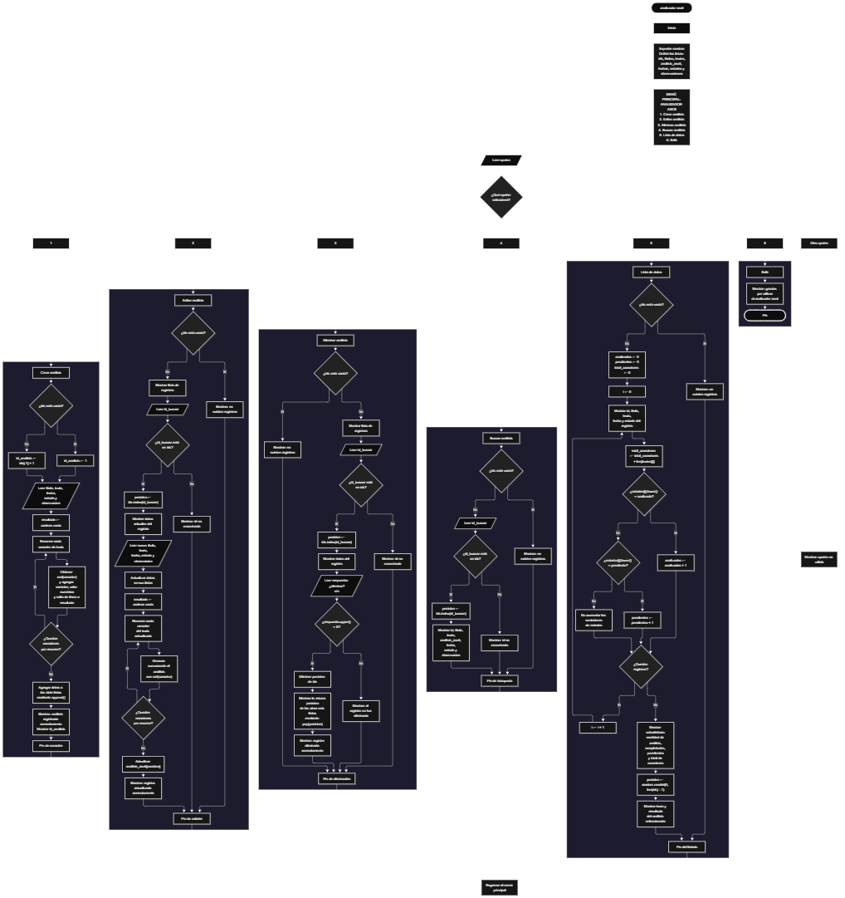

 

Este proyecto, llamado <b>analizador ascii</b>, fue desarrollado en <b>python</b> como un ejercicio práctico para fortalecer la lógica de programación mediante la creación de un sistema de análisis de caracteres desde la consola. El programa cuenta con un menú principal de seis opciones que permite <b>crear, editar, eliminar, buscar y consultar registros de análisis</b>, además de visualizar una lista de datos con estadísticas. Cada registro almacena información como el título, el texto, el análisis de sus caracteres, la fecha, el estado y una observación. Para organizar los datos, se utilizan siete listas relacionadas que conservan la información de cada registro mediante posiciones equivalentes. El análisis se genera recorriendo cada carácter del texto y obteniendo su valor numérico mediante la función <b>ord()</b>. Durante su desarrollo se aplicaron conceptos fundamentales de programación, como variables, listas, estructuras condicionales, ciclos repetitivos, búsqueda de registros, modificación de datos, eliminación de elementos y generación de estadísticas. Este proyecto permite poner en práctica los conocimientos adquiridos en Python y sirve como base para desarrollar sistemas de análisis más avanzados.

<h2 align="center">⚙️ Funcionamiento del menú principal</h2>

### ➕ Crear análisis

La opción <b>1) crear análisis</b> permite registrar un nuevo análisis en el sistema. Primero, el programa comprueba si la lista <b>ids</b> está vacía. Si no existen registros, asigna el identificador <b>1</b>; de lo contrario, obtiene el siguiente identificador sumando uno al último valor almacenado mediante la expresión <b>ids[-1] + 1</b>. Después, solicita el <b>título, texto, fecha, estado y observación</b> del análisis. Para generar el resultado, recorre cada carácter del texto mediante un ciclo <b>for</b> y utiliza la función <b>ord(caracter)</b> para obtener su valor numérico. Cada resultado se incorpora a la variable <b>resultado</b>, acompañado del carácter correspondiente y un salto de línea. Finalmente, almacena el identificador y todos los datos en sus respectivas listas mediante el método <b>append()</b>, muestra el mensaje <b>"análisis registrado correctamente."</b> e informa el identificador asignado.

### ✏️ Editar análisis

La opción <b>2) editar análisis</b> permite modificar la información de un análisis registrado. Primero, el programa comprueba si existen registros en la lista <b>ids</b>. Si está vacía, muestra el mensaje <b>"no existen registros."</b>. En caso contrario, presenta una lista con los identificadores, títulos, textos, fechas, estados y observaciones existentes. Después, solicita el identificador del registro que se desea editar y comprueba si está presente en la lista <b>ids</b>. Si lo encuentra, utiliza el método <b>index()</b> para obtener su posición y muestra los datos actuales. A continuación, solicita el nuevo título, texto, fecha, estado y observación, actualizando los valores de las listas correspondientes. Como el texto puede cambiar, el programa vuelve a recorrer sus caracteres y genera nuevamente el análisis ASCII, actualizando también la lista <b>analisis_ascii</b>. Finalmente, presenta el mensaje <b>"registro actualizado correctamente."</b>. Si el identificador no existe, muestra el mensaje <b>"id no encontrada."</b>.

### 🗑️ Eliminar análisis

La opción <b>3) eliminar análisis</b> permite eliminar un registro mediante su identificador. Antes de comenzar, el programa comprueba si existen registros almacenados. Si no hay datos, muestra el mensaje <b>"no existen registros."</b>. Si existen, presenta una lista con los identificadores, títulos, textos, fechas, estados y observaciones. Después, solicita el identificador que se desea eliminar y comprueba si se encuentra en la lista <b>ids</b>. Cuando existe, obtiene su posición mediante <b>index()</b> y muestra los datos del registro seleccionado. A continuación, solicita confirmación mediante la variable <b>respuesta</b>. Si el usuario introduce la letra <b>"s"</b> o <b>"S"</b>, el programa elimina los elementos correspondientes de las siete listas mediante el método <b>pop(posicion)</b>. De esta manera, se elimina la información del mismo registro en todas las listas. Finalmente, muestra el mensaje <b>"registro eliminado correctamente."</b>. Si el usuario no confirma la eliminación, presenta el mensaje <b>"el registro no fue eliminado."</b>. Si el identificador no existe, muestra el mensaje <b>"id no encontrada."</b>.

### 🔎 Buscar análisis

La opción <b>4) buscar análisis</b> permite localizar un registro mediante su identificador. Primero, el programa comprueba si existen registros almacenados. Si la lista <b>ids</b> está vacía, muestra el mensaje <b>"no existen registros."</b>. En caso contrario, solicita el identificador que se desea buscar y comprueba si está presente en la lista. Cuando encuentra una coincidencia, utiliza <b>index()</b> para obtener la posición del registro y muestra su información completa: <b>identificador, título, texto, análisis ascii, fecha, estado y observación</b>. El resultado del análisis se obtiene de la lista <b>analisis_ascii</b>, donde cada carácter aparece acompañado de su valor numérico. Si el identificador introducido no corresponde a un registro existente, presenta el mensaje <b>"id no encontrada."</b>. Esta función permite consultar un análisis específico sin necesidad de recorrer manualmente todos los datos.

### 📋 Lista de datos

La opción <b>5) lista de datos</b> permite visualizar los registros almacenados y consultar estadísticas generales del sistema. Primero, el programa comprueba si existen registros. Si no hay datos, muestra el mensaje <b>"no existen registros."</b>. En caso contrario, inicializa las variables <b>analizados, pendientes y total_caracteres</b> con el valor <b>0</b>. Después, utiliza un ciclo <b>for</b> para recorrer los registros y mostrar el identificador, título, texto, fecha y estado de cada análisis. Durante el recorrido, suma la cantidad de caracteres de cada texto mediante <b>len(textos[i])</b>. También comprueba el estado de cada registro utilizando <b>lower()</b>, incrementando el contador de análisis completados cuando el estado es <b>"analizado"</b> y el de pendientes cuando es <b>"pendiente"</b>. Al terminar, muestra la cantidad total de análisis, los análisis completados, los pendientes y el total de caracteres registrados en los textos. Finalmente, utiliza <b>random.randint(0, len(ids) - 1)</b> para seleccionar aleatoriamente un registro y mostrar su texto junto con el resultado de su análisis. Esta opción combina la consulta general de datos con estadísticas y una selección aleatoria de un análisis existente.

### 🚪 Salir del menú principal

La opción <b>6) salir</b> permite finalizar la ejecución del programa. Cuando el usuario selecciona esta opción, el programa muestra el mensaje <b>"gracias por utilizar el analizador ascii."</b> y utiliza la instrucción <b>break</b> para interrumpir el ciclo <b>while True</b>. De esta manera, finaliza el menú principal y termina la ejecución del programa. Si el usuario introduce una opción que no está contemplada entre las seis disponibles, el programa muestra el mensaje <b>"opción no válida."</b> y vuelve a presentar el menú para permitir una nueva selección.

<h2 align="center">🧠 Temas aplicados en el proyecto</h2>

### 📦 Variables

En este proyecto se utilizan variables para almacenar los datos introducidos por el usuario, controlar la selección del menú, generar los resultados del análisis y administrar las operaciones sobre los registros. También se utilizan variables auxiliares para localizar identificadores, controlar posiciones, solicitar confirmaciones y calcular las estadísticas generales del sistema. Cada variable cumple una función específica dentro de las operaciones de creación, edición, eliminación, búsqueda y consulta de los análisis.

🔢 **opcion:** Almacena la opción seleccionada por el usuario en el menú principal.

🆔 **id_analisis:** Almacena el identificador asignado al nuevo análisis.

📝 **titulo:** Guarda el título del análisis que se registra o modifica.

📄 **texto:** Almacena el texto que se desea analizar.

📅 **fecha:** Guarda la fecha introducida para el registro.

📌 **estado:** Almacena el estado del análisis, que puede introducirse como analizado o pendiente.

💬 **observacion:** Guarda la observación asociada al registro.

🔤 **resultado:** Almacena la representación del análisis generado a partir de los caracteres del texto.

🔡 **caracter:** Representa cada carácter recorrido durante la generación del análisis.

🔎 **id_buscar:** Almacena el identificador introducido para localizar un registro.

📍 **posicion:** Indica la posición del registro dentro de las listas.

❓ **respuesta:** Almacena la respuesta del usuario para confirmar o cancelar la eliminación.

📊 **analizados:** Cuenta los registros cuyo estado es igual a analizado.

⏳ **pendientes:** Cuenta los registros cuyo estado es igual a pendiente.

🔢 **total_caracteres:** Acumula la cantidad de caracteres de los textos registrados.

🔄 **i:** Funciona como contador en los ciclos utilizados para recorrer las listas.

### 🗃️ Listas

En este proyecto se utilizan siete listas relacionadas para almacenar la información de los análisis. Cada lista conserva un tipo de dato y utiliza la misma posición para representar la información correspondiente a un mismo registro. Por ejemplo, los datos de un análisis ubicado en la posición <b>0</b> se distribuyen entre <b>ids[0], titulos[0], textos[0], analisis_ascii[0], fechas[0], estados[0] y observaciones[0]</b>. Esta organización permite recorrer, buscar, modificar, consultar y eliminar los registros manteniendo la correspondencia entre sus datos. Las listas de Python pueden aumentar o disminuir de tamaño durante la ejecución, por lo que el código no establece una capacidad fija de registros.

🆔 **ids:** Almacena los identificadores de los análisis registrados.

📝 **titulos:** Guarda los títulos asociados a cada registro.

📄 **textos:** Almacena los textos originales que se desean analizar.

🔤 **analisis_ascii:** Guarda el resultado generado para cada carácter de los textos.

📅 **fechas:** Almacena las fechas de los registros.

📌 **estados:** Guarda el estado de cada análisis.

💬 **observaciones:** Almacena las observaciones correspondientes a cada registro.

### 🔀 Estructuras condicionales

En este proyecto se utilizan las estructuras <b>if, elif y else</b> para controlar el funcionamiento del programa según las condiciones de cada operación. Estas estructuras permiten identificar la opción seleccionada en el menú, comprobar si existen registros, verificar si un identificador está almacenado, determinar si se confirma una eliminación y clasificar los análisis según su estado. También permiten mostrar mensajes diferentes cuando una operación se completa, cuando no se encuentra un registro o cuando se introduce una opción no válida. De esta manera, el programa ejecuta las instrucciones correspondientes a cada situación.

### 🔄 Estructuras repetitivas

En este proyecto se utilizan las estructuras repetitivas <b>while</b> y <b>for</b>. El ciclo <b>while True</b> mantiene activo el menú principal para que el usuario pueda realizar diferentes operaciones hasta seleccionar la opción de salida, que utiliza <b>break</b> para finalizar el ciclo. Los ciclos <b>for</b> permiten recorrer los caracteres de un texto para generar el análisis, recorrer las listas para mostrar los registros y calcular estadísticas, así como presentar los datos disponibles antes de editar o eliminar un análisis. Estas estructuras facilitan la ejecución repetida de instrucciones sin tener que escribirlas individualmente para cada elemento.

### 🎯 Selección de opciones del menú

El programa utiliza una estructura condicional compuesta por <b>if, elif y else</b> para evaluar el valor almacenado en la variable <b>opcion</b> y ejecutar el bloque de instrucciones correspondiente. Cada condición representa una operación específica del sistema: <b>crear análisis, editar análisis, eliminar análisis, buscar análisis, mostrar la lista de datos o salir</b>. Cuando el valor introducido no coincide con ninguna de las opciones definidas, el bloque <b>else</b> muestra el mensaje <b>"opción no válida."</b>. Esta organización permite mantener las funcionalidades separadas dentro de un único menú principal.

### 🔢 Organización de listas

El programa utiliza listas de Python para almacenar los registros sin establecer una cantidad máxima fija de elementos. A diferencia de los arreglos dimensionados con una capacidad determinada, estas listas pueden aumentar de tamaño mediante el método <b>append()</b> cuando se crea un análisis y reducirse mediante <b>pop(posicion)</b> cuando se elimina un registro. La cantidad de registros se obtiene mediante <b>len(ids)</b>, que permite conocer cuántos identificadores están almacenados. Esta organización facilita administrar los datos durante la ejecución, aunque la información permanece en memoria y no se guarda automáticamente en archivos ni en una base de datos.

### 🔄 Organización de registros

Cuando se elimina un análisis, el programa obtiene su posición mediante el método <b>index()</b> y utiliza <b>pop(posicion)</b> para retirar el elemento correspondiente de cada una de las siete listas. Python reorganiza automáticamente los elementos restantes de cada lista después de la eliminación. Como el programa elimina la misma posición en <b>ids, titulos, textos, analisis_ascii, fechas, estados y observaciones</b>, los datos de los registros restantes mantienen su correspondencia. Este procedimiento permite eliminar un registro sin necesidad de programar manualmente un ciclo para desplazar los elementos posteriores.

<h2 align="center">¿Cómo se implementaron las operaciones crud en el proyecto?</h2>

Las operaciones <b>crud</b> se implementaron mediante las opciones del menú principal, permitiendo administrar los análisis registrados. La operación <b>crear</b> corresponde a <b>crear análisis</b>, donde se solicitan los datos y se almacenan en las listas mediante <b>append()</b>; <b>leer</b> se realiza mediante las opciones <b>buscar análisis y lista de datos</b>, que permiten consultar registros individuales, mostrar los datos almacenados y visualizar estadísticas; <b>actualizar</b> corresponde a <b>editar análisis</b>, donde se modifican los datos y se vuelve a generar el análisis del texto actualizado; y <b>eliminar</b> se realiza mediante la opción <b>eliminar análisis</b>, que retira los elementos de las listas después de confirmar la operación. Estas funcionalidades utilizan variables, listas, condicionales, ciclos y métodos de Python para gestionar la información temporalmente durante la ejecución del programa.

<h2 align="center">Diagrama de flujo del proyecto</h2>

<h2 align="center">🛡️ Validaciones del programa</h2>

### 📭 No existen registros

Esta comprobación se utiliza en las opciones de <b>editar, eliminar, buscar y lista de datos</b>. El programa comprueba si la lista <b>ids</b> está vacía y, cuando no existen registros, muestra el mensaje <b>"no existen registros."</b>. Esta comprobación evita continuar con las operaciones que necesitan información almacenada cuando todavía no se ha creado ningún análisis. La opción de creación permanece disponible para que el usuario pueda registrar el primer análisis.

### ❌ Identificador no encontrado

Esta comprobación se utiliza durante las operaciones de <b>editar, eliminar y buscar análisis</b>. El programa comprueba si el identificador introducido se encuentra dentro de la lista <b>ids</b>. Si existe, obtiene su posición mediante <b>index()</b> y continúa con la operación correspondiente. Si no existe, muestra el mensaje <b>"id no encontrada."</b>. Esta comprobación permite distinguir los identificadores almacenados de aquellos que no corresponden a ningún registro existente.

### 🗑️ Confirmación de eliminación

Antes de eliminar un registro, el programa muestra sus datos y solicita una respuesta mediante la variable <b>respuesta</b>. La eliminación se realiza únicamente cuando la respuesta, convertida a mayúsculas mediante <b>upper()</b>, es igual a <b>"S"</b>. Si el usuario introduce esa letra, se eliminan los datos de la posición correspondiente en las siete listas y se muestra el mensaje <b>"registro eliminado correctamente."</b>. En caso contrario, el programa muestra el mensaje <b>"el registro no fue eliminado."</b>. Esta comprobación permite confirmar la operación antes de retirar el registro.

### 📌 Clasificación de estados

Durante la opción <b>lista de datos</b>, el programa utiliza la variable <b>estado</b> para clasificar los registros y calcular las estadísticas. Mediante el método <b>lower()</b>, convierte el estado a minúsculas antes de compararlo con los valores <b>"analizado"</b> y <b>"pendiente"</b>. Si coincide con el primero, aumenta el contador <b>analizados</b>; si coincide con el segundo, aumenta el contador <b>pendientes</b>. Sin embargo, el programa no impide que el usuario introduzca otros estados durante la creación o edición. Por ello, los registros con estados diferentes de esos dos valores no se incluyen en ninguno de los contadores.

### 🔢 Entrada numérica

En las opciones de <b>editar y eliminar análisis</b>, el programa utiliza la función <b>int()</b> para convertir el identificador introducido por el usuario en un número entero. Sin embargo, no existe una comprobación previa que permita controlar entradas que no sean numéricas. Si se introduce un valor que no puede convertirse a entero, Python puede generar un error y detener la ejecución. Por tanto, el código actual realiza la comprobación de existencia del identificador, pero no incluye una validación para manejar entradas numéricas incorrectas.

### ⚠️ Opción inválida

La estructura condicional del menú incluye un bloque <b>else</b> que muestra el mensaje <b>"opción no válida."</b> cuando el usuario introduce un valor que no coincide con las opciones del menú. Las opciones disponibles van del <b>1</b> al <b>6</b>. Esta comprobación permite que el programa vuelva al menú principal cuando se introduce una opción diferente, sin ejecutar ninguna de las operaciones anteriores.

<h2 align="center">🎯 Objetivo del proyecto</h2>

El objetivo principal de este proyecto es fortalecer la <b>lógica de programación</b> mediante el desarrollo de un sistema de análisis de caracteres en <b>python</b>. A través de su construcción se busca aplicar los conocimientos adquiridos sobre variables, listas, estructuras condicionales, ciclos repetitivos y operaciones con cadenas de texto, integrándolos para resolver un problema de manera organizada. Además, el proyecto permite comprender cómo registrar, consultar, modificar y eliminar información, generar representaciones numéricas de los caracteres mediante la función <b>ord()</b> y calcular estadísticas a partir de los datos almacenados. De esta manera, se establece una base para desarrollar sistemas de análisis más completos utilizando otros lenguajes y tecnologías.

